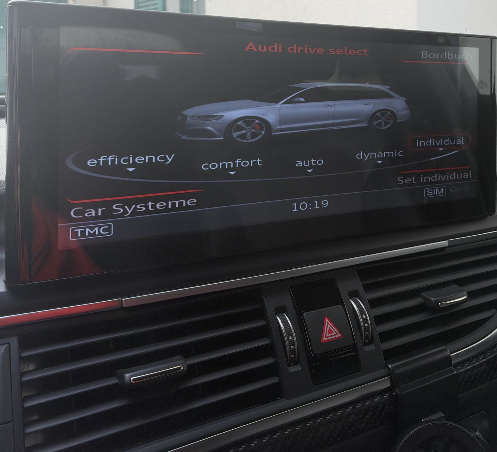
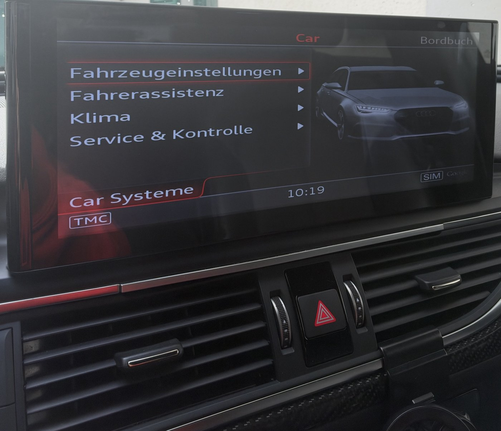
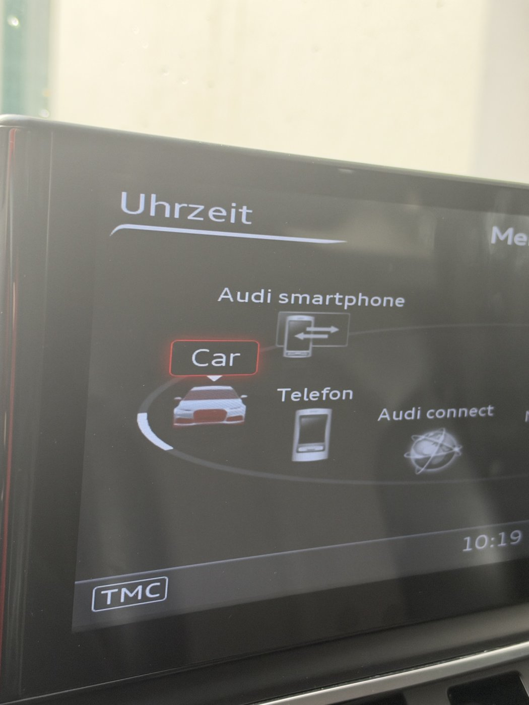

# Audi MIB2 High (C7 A6 / A7) – DIY: CarPlay map in the virtual cockpit, custom 3D car model, car menu icon, rear-camera research

Everything we learned modding an **Audi A6 Avant C7.5 (2018)** with **MIB2 High** (MHI2, Harman, QNX)
running `MHI2_ER_AU57x_K3663_1`, written down so you don't have to pay 100+ EUR to someone for things
you can do yourself for free.

**Search keywords:** Audi A6 A7 S6 S7 RS6 RS7 C7 C7.5 4G · MIB2 High · MHI2 · MMI 3G+ successor · virtual cockpit / FIS /
cluster · CarPlay map in cluster · Android Auto map in cluster · 3D car model · car look · drive select car ·
content.kzb · Kanzi KZB format · car menu icon · rear view camera in cluster · dmdt display manager · SWDL SD update

> [!CAUTION]
> **This repository is meant as information – a write-up of what we learned, in the hope it helps others.
> It is not a ready-made product and not a step-by-step guarantee.**
>
> - You can do **a lot wrong** here. A wrong file on `/mnt/app`, a broken update package or a script that runs on
>   the wrong software version can leave your MMI without graphics, in a crash loop, or worse – and fixing that
>   may need SSH access, a dealer, or a replacement unit.
> - Everything was done on **ONE car** (Audi A6 Avant C7.5, `MHI2_ER_AU57x_K3663_1`). Other cars, other
>   software trains or other hardware can have different files, offsets and behaviour. Do **not** copy numbers,
>   hashes or files from here onto your unit blindly.
> - Nothing here is official, nothing is tested beyond our own car, and **you do it entirely at your own risk**.
>   No warranty, no support obligation, no liability – see the [LICENSE](LICENSE).
> - **Not everything written here has to be right.** Only what we actually tested in our car is confirmed
>   (marked "tested" / "works"). Explanations of *why* something works or doesn't are our best understanding,
>   not proven facts.
> - When we write that something **"doesn't work" or "isn't possible"**, it means **we** didn't find a way and,
>   from what we know, it is *probably* not possible – not that it is impossible. Someone with more knowledge
>   or other tools may well manage it. Corrections and better findings are very welcome (issues / pull requests).
> - Only continue if you understand what each step does. Read [docs/00-safety.md](docs/00-safety.md) first,
>   make a **full M.I.B. backup** (including the advanced app backup) and have a working rollback **before** you change anything.

## Result in the car

| Audi drive select | Car menu | Main menu "Car" icon |
|---|---|---|
|  |  |  |

RS6 Avant body in silver grey, 3.5 cm lower, RS7 5-arm rims, red calipers, black exhaust tips / rings / trim,
no badge – and a matching car in the main-menu icon. Everything is generated by the MMI itself from the modified
`content.kzb`; no images of the car are "pasted" anywhere.

> **About the screen in the photos:** this car has an aftermarket Android screen with an LVDS box in front of
> the MMI. It plays **no role** for the 3D model or the icon – the box only passes through the MMI's 800×480
> picture. The mod is done inside the MMI and looks the same on the factory screen.

## What works (tested in the car)

| Feature | Status | How |
|---|---|---|
| **CarPlay / Android Auto map in the virtual cockpit (FIS)** | ✅ works | **Not our work** – it's [MacsInSpace/mib-cluster-map](https://github.com/MacsInSpace/mib-cluster-map) (GPL-3.0). We only tested it on K3663: v1.2.6 works with default settings. See [docs/02](docs/02-carplay-map-in-cockpit.md) |
| **Custom 3D car model** (car menu + Audi drive select) | ✅ works | Our tools: swap the model (e.g. A6 → RS6), paint colour, lower the car, swap rims, red calipers, black exhaust tips/rings/trim, remove badges. See [docs/04](docs/04-3d-car-model.md) |
| **Custom "Car" icon in the main menu** | ✅ works | Replace two PNGs inside `content.kzb` with the exact same byte length. See [docs/05](docs/05-car-menu-icon.md) |
| Safe installer for `content.kzb` via SD update | ✅ works | SHA1-checked install + automatic backup + one-click uninstall. See [docs/06](docs/06-swdl-installer.md) |
| Rear camera in the cockpit | ❌ not with scripts (as far as we know) | The switching works, but the camera seems to be a hardware video layer the cluster can't see. Probably needs a native capture program. Full research: [docs/07](docs/07-display-manager-and-rear-camera.md) |
| Satellite map in the cockpit, sharper CarPlay, touch, two CarPlay screens | ❌ not possible as far as we know | Most likely hardware / Apple limits, see [docs/08](docs/08-limits-faq.md) |

## Contents

- [docs/00-safety.md](docs/00-safety.md) – how not to brick your unit, backups, rollback
- [docs/01-unit-basics.md](docs/01-unit-basics.md) – MIB2 High layout (RCC / MMX), menus, where files live, what tools exist on the unit
- [docs/02-carplay-map-in-cockpit.md](docs/02-carplay-map-in-cockpit.md) – using mib-cluster-map, our results on the A6 C7.5
- [docs/03-kzb-format.md](docs/03-kzb-format.md) – **the Kanzi `.kzb` format, decoded** (directory, meshes, materials, scene nodes, images)
- [docs/04-3d-car-model.md](docs/04-3d-car-model.md) – **changing the 3D car model step by step** (model swap, paint, lowering, rims, calipers, black parts, badges)
- [docs/05-car-menu-icon.md](docs/05-car-menu-icon.md) – **replacing the "Car" icon in the main menu**
- [docs/06-swdl-installer.md](docs/06-swdl-installer.md) – building an SD update package (metainfo2.txt, FinalScript, checksums), installer safety design
- [docs/07-display-manager-and-rear-camera.md](docs/07-display-manager-and-rear-camera.md) – `dmdt`, contexts and displayables, rear camera measurements
- [docs/08-limits-faq.md](docs/08-limits-faq.md) – what is NOT possible and why, paid solutions, aftermarket screens
- [docs/09-startup-image-canim.md](docs/09-startup-image-canim.md) – the `.canim` boot animation format
- [tools/](tools/) – all our scripts (Python 3 on the PC, ksh on the unit)

## What is NOT in this repo (on purpose)

No Audi files: no `content.kzb`, no extracted meshes, no Audi images, no firmware. They are copyrighted.
Every tool here works on **the file from your own car** (you get it with an M.I.B. backup, see docs/01).
Third-party projects are linked, not copied.

## Paid solutions

There are people selling "cluster mods" (CarPlay in the cockpit, video, rear camera in the cockpit, car look)
for around 100–150 EUR, often paid in crypto. The CarPlay-map part is available for free (mib-cluster-map),
and the car-look part is documented here. What we found about how the rear-camera feature probably works
is in [docs/07](docs/07-display-manager-and-rear-camera.md). Note: on this car, **everything** shown in the
cockpit by the MMI only appears in the cockpit's **navigation tab** – that is a limit of the instrument
cluster as far as we can tell, and we know of no solution that gets around it.

## Other interesting projects

- [tfourj/MIB2-Patcher](https://github.com/tfourj/MIB2-Patcher) – patches for exactly this software train
  (`MHI2_ER_AU57x_K3663_1`, A6/A7 C7): e.g. the steering-wheel star (joker) button skipping tracks in
  CarPlay / Android Auto, freely assignable joker/voice button, TEL opens CarPlay, and detailed findings about
  the cockpit display chain. Pointed out to us by a user in [issue #1](../../issues/1). **Not tested by us** –
  it changes the Java HMI (`lsd.sh` / boot classpath), so read its docs and have a full backup + SSH first.
  Worth a look for anyone interested in MMI modding.

## Credits

- [MacsInSpace/mib-cluster-map](https://github.com/MacsInSpace/mib-cluster-map) – phone map on the digital cluster (GPL-3.0). All CarPlay-in-cockpit work is theirs.
- [M.I.B. – More Incredible Bash](https://github.com/Mr-MIBonk/M.I.B._More-Incredible-Bash) – backup, SSH, the QNX `sha1sum` we use (GPL-2.0)
- [jilleb/mib2-toolbox](https://github.com/jilleb/mib2-toolbox) – the green-menu toolbox and lots of MIB2 knowledge
- The MIB2 community on GitHub, Audizine and elsewhere
- Research, reverse engineering of the `.kzb` format and the tools were done together with **Claude** (Anthropic's AI assistant, via Claude Code).

## License

Our scripts and docs: GPL-3.0 (see [LICENSE](LICENSE)), compatible with the projects we build on.
`tools/camera/savelogs.sh` is a modified file from mib-cluster-map (GPL-3.0).
