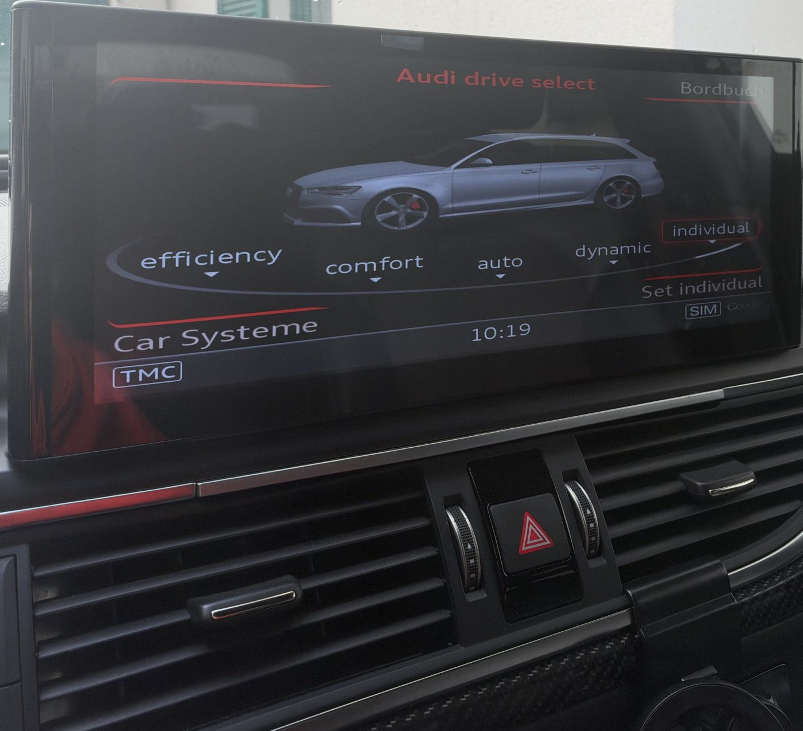

# 04 – Changing the 3D car model (car menu + Audi drive select)



What we did on an A6 Avant C7.5: the car menu and drive select now show an **RS6 Avant** body in silver grey,
**3.5 cm lower**, with **RS7 5-arm rims**, **red brake calipers**, **black exhaust tips**, **black rings and rear trim**
and **no RS6 badge**. Startup animation unchanged. Installed and running in the car.

**Rule we kept everywhere: only in-place edits.** The file keeps its size and its directory; we only change
bytes inside existing entries. That keeps the risk low and the installer simple (same size = easy SHA1 check,
no relocation of 5000+ entries). Things that need *new* geometry (front lip, side skirts, rear splitters) were
designed in the preview but **not** installed, because they need the file to grow (see the end).

Format details: [docs/03](03-kzb-format.md). Install: [docs/06](06-swdl-installer.md).

## 0. Setup

```
pip install numpy opencv-python moderngl
mkdir work && cp <your backup>/eso/content.kzb work/
export MIB_WORK=$PWD/work            # (Windows: set MIB_WORK=...)
python tools/kzb/kzb_dir.py work/content.kzb work/kzb_dir.json
python tools/kzb/kzb_extract.py work/content.kzb work/obj        # OBJ files to look at in Blender
```

## Stage 1 – show a different model + paint colour ([`stage1_swap_model.py`](../tools/carlook/stage1_swap_model.py))

**Idea:** the A6 Avant menu scenes (`AU572_Avant_PA_CarMenu_*`, `AU572_Avant_PA_CharismaView_*`) contain
type-170 placeholders that point at the four child nodes of `AU572_Avant_PA_Geometry`:

| A6 Avant node (index) | RS6 Avant node (index) |
|---|---|
| `AU572_A6_PA_Polymodel` (2189) | `Exterior` (3456) |
| `AU572_A6_PA_Mirrormodel` (2190) | `Mirror` (3455) – the reflection under the car |
| `AU572_A6_PA_Interior_right` (2191) | `Interior_right` (3458) |
| `AU572_A6_PA_Interior_left_grp` (2192) | `Interior_left` (3457) |

Re-pointing the **12 placeholders** (car menu + drive select, left- and right-hand drive, exterior /
reflection / interior) from the A6 nodes to the RS6 nodes = **12 × 4 bytes**. The camera still fits because
the A6 polymodel (cm, scale 0.015, axis swap) has the same bounding box as the RS6 model.
Works the same for any other model in the file (S6, allroad, A7, S7, RS7 …) – just map to that model's
`_Geometry` children. Check which scenes your car actually uses (left/right-hand drive, Avant/saloon).

**Paint:** the paint is a material property, e.g. `/Materials/PhongTexturedCube/AU572_RS6_PA_Paint`,
property 0x63 (diffuse), 3 floats. Stock is a neutral grey 0.79/0.77/0.75 (the same for A6/S6/RS6 –
Audi doesn't show the real paint colour). We used **0.74 / 0.755 / 0.775** (slightly blue silver grey).
Any colour works: write 3 floats in place. Ambient (0x60) and specular (0x67) can be tuned the same way.

Result: 13 small byte ranges changed. Verified: only those ranges differ, the directory is identical,
all 135 meshes still parse and rebuild byte-identically.

## Stage 2 – lower, rims, calipers, black parts, badge ([`stage2_lower_rims_calipers_black.py`](../tools/carlook/stage2_lower_rims_calipers_black.py))

### A) Lowering (node matrices)
`/Scenes/AU572_RS6_Avant_PA_Geometry/Root Node/{Exterior, Interior_left, Interior_right}`: translation Y
(float 13 of the 0x0b matrix) **−0.035**. The `Mirror` group (reflection, upside down) gets **+0.035**.
The wheels are children of `Exterior`, so they would go down too – that's why the wheel meshes are moved
back up by +0.035 in step B (body lower, wheels stay on the ground = more wheel in the arch).

### B) Different rims (RS7 5-arm on the RS6)
The file contains the RS7 wheels (`/Mesh Data/AU573_RS7_PA_Wheel_FL`, `_FR`, `_rear`). We
- moved their vertices onto the RS6 axle positions (front x −2.165, rear x 2.208, y 0.52),
- pushed each side so the outer tyre face sits at z 1.10 (left) / −1.78 (right) like the RS6 wheels,
- added +0.035 in y (see lowering),
- updated the mesh bounding box (tail),
- and changed the RS6 wheel **nodes** (`Exterior/AU572_RS6_PA_Wheel_FL`, `_FR`, `_Wheels_Back`) to reference
  the RS7 meshes (last u32 of the node).

Same vertex count, same index count → same size.

### C) Red calipers (from the brake disc)
There is no caliper in the model. Sub-mesh 2 of each RS7 wheel is the brake disc. We **rebuilt those
triangles into a caliper**: a curved block (angle 5°–65°, radius 0.19–0.31 m, 6 segments) placed just inside the
rim, behind the spokes. Vertices that are not needed are parked inside the caliper, unused triangles made
degenerate. Then the material `AU573_RS7_PA_BrakeDisc` was made red:
ambient (0.22, 0.01, 0.01), diffuse (1.0, 0.06, 0.05), specular (0.6, 0.35, 0.35).
(This also means there is no visible disc any more – the caliper is what you notice.)

### D) Black exhaust tips, black rings and trim, badge removed
In `/Mesh Data/AU572_RS6_PA_Avant_Exterieur` the sub-meshes are: 0 = matt black (material 486),
2 and 3 = chrome (material 420); sub-mesh 3 is the **exhaust tips**.
- **Exhaust tips black:** change sub-mesh 3's material reference 420 → 486. 4 bytes.
- **Rings front + rear and the rear chrome strip black:** select chrome triangles by their centre
  (front: x < −3.3, y > 0.84, |z − centre| < 0.3; rear rings: x > 3.3, y > 1.12; strip: x > 3.3, y < 0.975)
  and **move them from sub-mesh 2 into sub-mesh 0** (matt). Total triangle count stays the same, so the size
  stays the same (we keep the moved count even).
- **RS6 badge removed:** the badge triangles (x > 3.3, 0.975 < y < 1.12, z − centre > 0.45) become degenerate.

### E) Verification
Every changed byte range is recorded; a check compares original and new file: only planned ranges differ,
the directory is identical, 135/135 meshes parse, all indices are inside their vertex buffers, no NaN.
Then `tools/preview/render_from_kzb.py` renders the finished file from 9 angles + a wheel close-up.

## Pipeline we actually ran

```
python tools/carlook/stage1_swap_model.py work/content.kzb work/content_stage1.kzb work/kzb_dir.json
python tools/carlook/make_menu_icon.py           # optional, see docs/05 (needs the preview builder)
python tools/carlook/stage1b_menu_icon.py        # -> work/content_stage1b.kzb
python tools/carlook/stage2_lower_rims_calipers_black.py   # -> work/content_stage2.kzb
python tools/preview/render_from_kzb.py work/content_stage2.kzb check.jpg
```

With the original K3663 file this produces exactly the file running in our car
(SHA1 stage 1 `9133f014…`, stage 1b `a21362e1…`, stage 2 `674a2ef4c80dcee898dec2c6ff439c6d7f5a6b10`).
On other software versions the indices/offsets may differ – the scripts look everything up by path and
`assert` what they expect, so they stop instead of writing nonsense. Adapt the numbers, never remove the asserts.

## Designing on the PC first

`tools/preview/` contains the preview builder we used to try designs before touching the file.
It works on the OBJ files from `kzb_extract.py` (`MIB_WORK/obj`):

- `design.py` – the final RS6 design as PC preview; `python tools/preview/design.py out.jpg` renders 9 views.
  The car (photos) runs a subset of it, made by the stage scripts: model swap + paint, lowering, RS7 rims, red calipers,
  black exhaust tips/rings/trim, badge removed. Honeycomb grille, black roof rails, lip/skirts/splitters are preview only.
  The menu icon (`carlook/make_menu_icon.py`) is rendered from this full preview scene.
- `scene.py`, `glrender.py` – scene container and the GPU renderer
- `grille.py` – RS honeycomb grille projected onto the body
- `bodykit.py` – front lip, side skirts, rear splitters that follow the real body edges (preview only, see below)
- `obj_preview.py` – OBJ loader + a quick contact sheet to find out which mesh number is which part
- `archive/` – earlier design iterations (S6 body, diffuser fins, a custom 5-arm rotor rim). Not maintained,
  kept as examples.
Keep the polygon count low – the MMI's Tegra 3 renders this; smoothness comes from the normals, like the original.

## Not done (needs a bigger file)

New parts (front lip, side skirts, rear splitters, roof-spoiler extension) need **more vertices/triangles**
than any existing mesh can give up. That means appending data at the end of the file and rewriting the
offsets/sizes in the directory (the directory format is fully known, see docs/03). Probably fine, but we did not
take that risk on our unit. If you do: keep the directory entry count unchanged, append, update offset + size,
re-run the full parse check, and test the uninstall path first.

## Ideas that are easy with the same method

- Any paint colour (also per model), red interior (interior material diffuse), tinted glass (glass material).
- A different stock model per body style (e.g. S6 Avant, allroad).
- Other rims from the file (S6, A7, RS7 …) on any body: move + re-point the wheel nodes.
- Hide parts (badges, roof rails) with degenerate triangles; recolour parts by moving triangles between sub-meshes.
