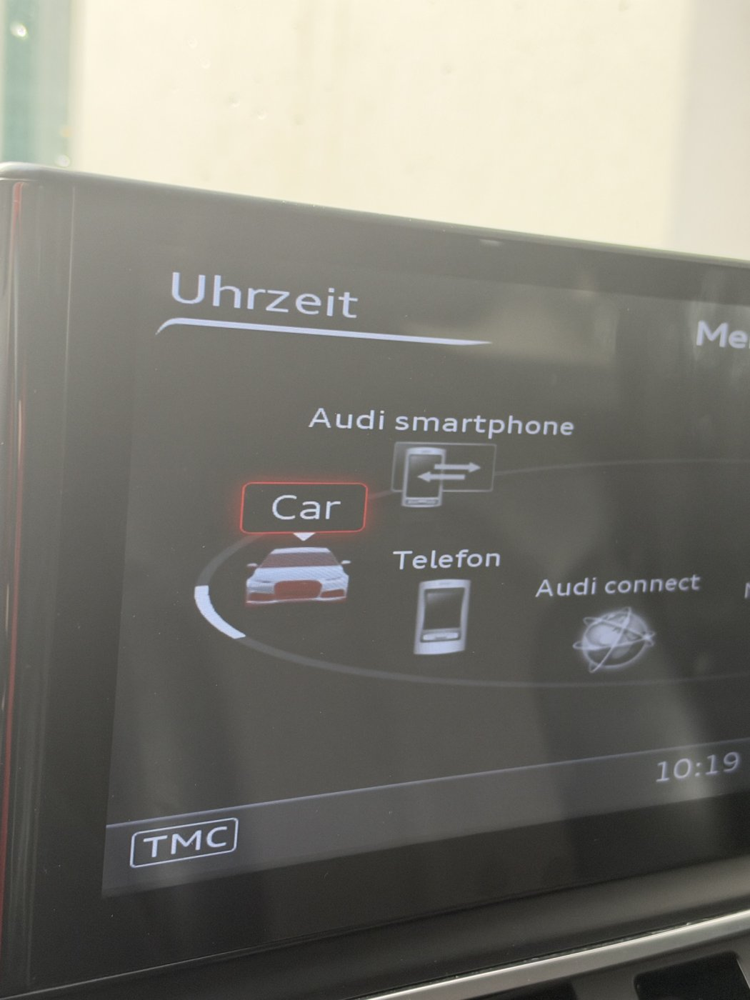

# 05 – Replacing the "Car" icon in the main menu

The little car in the MMI main menu ("Car" / "Fahrzeug") is **not** a 3D scene – it's two PNG images inside
`content.kzb`:

| Index | Path | Size in file |
|---|---|---|
| 4989 | `/Resource Files/Images/WizardIcons/Main Wizard/2D/d4_wizard_maingroups_car_enabled.png` | 7482 bytes |
| 4990 | `/Resource Files/Images/WizardIcons/Main Wizard/2D/d4_wizard_maingroups_car_highlighted.png` | 8329 bytes |

(indices from our K3663 file – find yours by path in `kzb_dir.json`). Both are **65×48 RGBA**. *enabled* = normal state (white car),
*highlighted* = selected (dark parts tinted red). Transparent background; the car
sits at the bottom of the canvas.

## Making the new icon ([`make_menu_icon.py`](../tools/carlook/make_menu_icon.py))

1. Render your car (we used our modified model) from the front-left at a long focal length (fov 12°) on a
   transparent background.
2. Crop to the visible pixels, scale it to the size of the car in the original icon and place it at the same
   position (bottom aligned, centred).
3. Brighten it like the original white icon car.
4. For the highlighted version, blend dark areas (glass, grille, lights) towards red, as Audi does.
5. Compare with the originals at 5× zoom on a dark background.

## Putting it into the file without changing sizes ([`stage1b_menu_icon.py`](../tools/carlook/stage1b_menu_icon.py))

The new PNG must be **exactly as long** as the old one, so the directory doesn't change:

1. Encode the new image with maximum compression (`cv2.IMWRITE_PNG_COMPRESSION, 9`). It must be *smaller*
   than the original. If not: fewer colours / simpler image.
2. Insert a `tEXt` chunk (keyword `Comment`) just before `IEND` and fill its text so the total length matches
   exactly (12 bytes chunk overhead + keyword + text). PNG readers ignore it.
3. Check: width, height, bit depth and colour type identical to the original; decoding the padded PNG gives
   exactly our pixels; the 4 bytes before the PNG in the entry are still zero.
4. Write it at `offset + 4` of the entry.

Result in our car: the main menu shows our grey RS6-style car instead of the stock A6.

## Other images

The same works for any of the 1215 PNGs in the file (`tools/kzb/kzbpng.py` dumps them all):
wizard icons, drive select graphics, etc. Always: same dimensions, same colour type, same byte length.
