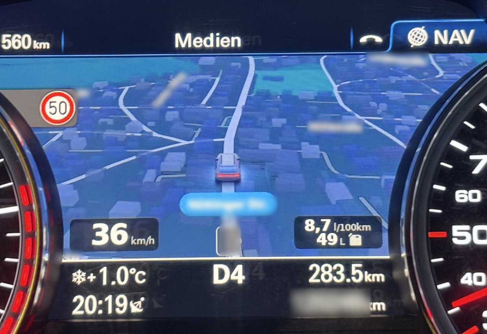
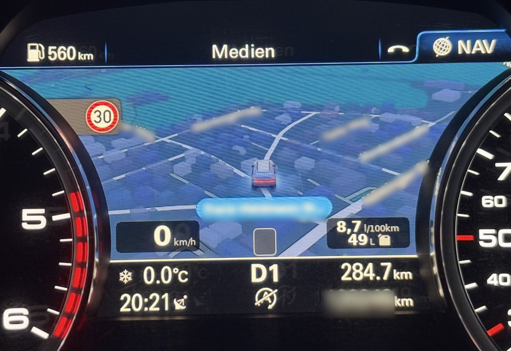
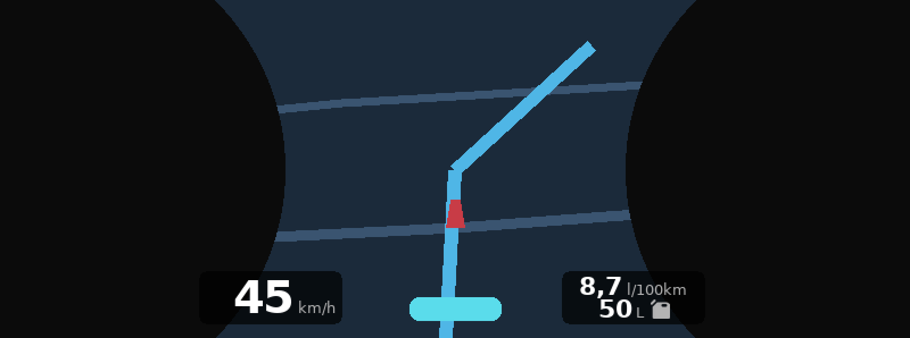

# 13: Cockpit overlay over the CarPlay map: speed, consumption, fuel, quiet street label

**Status (2026-11-25): our current final version for the cockpit.** It runs in our car every day and looks
right on the road. "Final" means: this is the state we are happy with for now. We keep driving with it and
will update this page if something changes.

> Tested on **one** car: Audi A6 Avant C7.5, `MHI2_ER_AU57x_K3663_1` (MU1425), with mib-cluster-map **v1.2.6**
> and MIB2-Patcher JOKERBTN + TOUCHCURSOR. It changes the Java HMI start (`lsd.sh`), replaces
> mib-cluster-map's stream player and changes one of mib-cluster-map's setting files. Full M.I.B. backup
> first, see [docs/00](00-safety.md). The scripts refuse any other `lsd.jxe` and any other player (sha1
> checks) and keep the originals for the way back.

| Driving, no route | Stopped at a junction |
|---|---|
|  |  |

*In our car: CarPlay map from mib-cluster-map, our speed box (left) and fuel box (right), CarPlay's blue
street name just above the cluster's own (now empty) street bar. Long street names are shortened by CarPlay
itself ("…"). Street names and the odometer are blurred on purpose.*



*The exact bitmaps the player draws, rendered on the PC (window 800×298, 2× enlarged, stand-in map).*

## What you get

| Feature | What it does | Status |
|---|---|---|
| **Speed box** (left) | Speedometer value, `45 km/h`. Fixed size, digits right-aligned so "km/h" never moves, whether 4, 40 or 140 | ✅ in the car |
| **Fuel box** (right) | Long term consumption `8,7 l/100km` over the estimated fuel left `50 L` with a jerrycan | ✅ in the car |
| Both boxes | Exactly the same size (126×47), 70 % opaque, 175 px from the left / 180 px from the right edge, 12 px from the bottom | ✅ in the car |
| **No flicker** | Boxes stay on, also with cruise control (nothing changes for minutes) | ✅ in the car |
| **Quiet street label** | While the CarPlay map is up, the Audi navigation's street name never reaches the cluster; its bar stays as a small empty box. Without CarPlay (phone flat, Audi nav) everything is as before | ✅ in the car |
| **CarPlay street name above it** | CarPlay's own blue street name sits just above that empty box instead of on top of it. The map shrinks a little with it, so you still see as much road | ✅ in the car |
| **Turn card right** | CarPlay's turn card moves away from the traffic sign at the top left, and stays readable | ✅ in the car |
| **Patch re-arm** | Re-arms VehLog, TOUCHCURSOR and JOKERBTN when their boot guard switched them off after a short start | ✅ |

## How it works

```
 Java HMI (lsd.jxe)                                       mib-cluster-map stream player (MMX)
 ┌──────────────────────────────┐   /tmp/vehlog_speed    ┌──────────────────────────────────┐
 │ VehLog                       │   "45 1234"            │ every 300 ms: read both files     │
 │  speed  <- DSICarVehicleStates│ ─────────────────────▶ │ new counter = VehLog alive        │
 │  range, consumption <- Kombi │   /tmp/vehlog_fuel     │ draw two boxes over the map       │
 │  street filter (KOMO)        │   "87 50 617"          │ (own GLES2 shader, texture unit 3)│
 └──────────────────────────────┘ ─────────────────────▶ └──────────────────────────────────┘

 mib-cluster-map's safe area file (read by the iPhone when it connects):
   original  x=127 y=0 w=546 h=298   ->   ours  x=127 y=0 w=546 h=262   (bottom edge 36 px higher)
```

- **VehLog** ([`tools/vehlog/`](../tools/vehlog/), background in [docs/11](11-vehicle-data-logger.md)) listens
  to the car's values inside the Java HMI and writes two tiny files to `/tmp` (RAM): the value(s) plus a
  **write counter**. It rewrites them every 2 s and the speed also on every change.
- **The player** ([`tools/speedoverlay/`](../tools/speedoverlay/)) is mib-cluster-map v1.2.6 plus 3 lines and
  three headers. Once per frame, after the map and before `eglSwapBuffers`, it draws the boxes with its own
  small shader. A box is hidden only when VehLog has written nothing new for 6 s (VehLog stopped) or
  `/tmp/speedoverlay-off` exists. No file, no box: the map itself is never touched.
- **Speed** is the speedometer value from `DSICarVehicleStates` attribute 14. The car sends it about **once a
  second** (we measured at most 1.2 updates per second over whole minutes of driving). That is the fastest
  speed source the MMI has, so under hard acceleration the number steps about once a second.
- **Fuel left** is an estimate: our car never sends the tank content in litres (`BCTankLevel1` is always
  invalid), so VehLog computes `litres = range km × long term consumption / 100` from `BCCurrentRange1` and
  `BCLongTermAverageConsumption1`. The cluster computes the range from the real tank level, but with its own
  recent consumption, so expect roughly ±10 %. Whole litres only. A line stays empty when its value is invalid.
- **Street label filter:** the navigation's `ClusterService` asks `DSIKOMOManager.getDSIKOMONavInfo()` for the
  cluster interface every time it sends a street. VehLog hands the manager a thin wrapper
  (`setDSIKOMONavInfo`, the same public call the navigation's own Activator uses). It passes **every** call
  through unchanged, except `setCurrentStreet` / `setTurnToStreet` while the CarPlay map is up (mib-cluster-map
  writes `streaming` to `/tmp/mibr-carplay111.state`): those go out as a single space. When CarPlay goes away,
  the last real street is sent again at once. If the navigation replaces the interface, VehLog puts the
  wrapper back within 3 s; if wrapping is not possible, it falls back to sending a blank right after each
  street change.
- **CarPlay's street name above the empty bar:** mib-cluster-map tells the iPhone a "safe area" (the part of
  the window the dials do not cover) in `/mnt/app/root/mibr-carplay111-safearea.conf`, read when the iPhone
  connects. The iPhone puts its street name at the bottom of that area and fits the map into it. Our launcher
  makes the area 36 px shorter at the bottom (x, y and width unchanged, so the turn card at the top stays where
  it is). The map shrinks a little with it, so we did not need to zoom out. 50 px was too much (the turn card
  got too small to show its text), 33 was nearly right, 36 is what we use.

### Why a small empty box and not nothing

The street bar and the traffic sign are drawn **by the cluster itself**, over whatever map it gets (see
[docs/11](11-vehicle-data-logger.md#cockpit-window-what-is-drawn-by-whom)). A single space gives the smallest
bar we have seen. `DSIKOMONavInfo.setCapabilities(boolean[2])` (the HMI sends `{true, true}` when it
connects) might switch the bar off, but nothing in the HMI says what the two flags mean, so we have not tried
it yet.

## Settings (files on the SD card, applied by the next script run)

| File | We use | Meaning |
|---|---|---|
| `vehlog/speedoverlay.conf` | `pos=bl` `left=175` `bottom=12` `fuel=on` `fuelright=180` `alpha=179` | speed box corner and distance from the edges in pixels (`pos=bl\|br\|tl\|tr`, `left=`, `right=`, `top=`, `bottom=`), fuel box on/off and distance from the right edge, box opacity (`alpha=` 40 to 255, 255 = solid black). Read when the player starts (MMI restart) |
| `vehlog/carplay_card.txt` | `right` | CarPlay turn card: `left`, `right`, `top`, or `iphone` (back to the phone's choice). mib-cluster-map's own setting, active when the iPhone connects |
| `vehlog/street_blank.txt` | `on` | `off` lets the Audi street name through again, within a few seconds |
| `vehlog/carplay_safearea.txt` | `36` | pixels the bottom of CarPlay's safe area moves up; `0` puts mib-cluster-map's original back exactly. Always worked out from the original (kept as `.vehlog.orig`), so running the script twice does not add up. Active when the iPhone connects |

On the C7 the player window is 800×298; the rev counter covers about the left 175 pixels and the speedometer
about the right 175.

## Install and way back (no SSH needed)

Build the jar and the player first (see the READMEs in [`tools/vehlog/`](../tools/vehlog/) and
[`tools/speedoverlay/`](../tools/speedoverlay/); we do not publish binaries). Then, with M.I.B. on the unit:

1. Copy `vehlog/` and `mod/command.sh` from `tools/vehlog/sd/` to the M.I.B. SD card, together with your
   `VEHLOG.jar` + `.sha1` and `stream-player.speed` + `.sha1`.
2. Phone unplugged, ignition on: green menu → M.I.B. → Advanced Settings → **Run individual script**
   (3 to 4 minutes; it checks the firmware first).
3. Restart the MMI and **leave it on for 2 minutes** (boot guards).
4. Plug the iPhone in. Run the script once more at the end of a drive to copy the logs to `vehlog/logs/`.

Way back, step by step:
- street name as before: `street_blank.txt` = `off`
- CarPlay's safe area as before: `carplay_safearea.txt` = `0`, then plug the iPhone in again
- everything: an empty file `vehlog/UNINSTALL` on the card, run the script, restart. That restores the
  original player (kept as `stream-player.mcm126`, sha1 checked) and `lsd.sh` byte for byte.

## What we learned on the way (so you don't have to)

- **The RCC shell has no `tr`.** Our first launcher read `carplay_card.txt` with `head | tr` and silently got
  an empty string, so the card and the street setting never applied. The launcher now reads files with shell
  builtins only (`read`, `set --`, `case`, `$(( ))`), and Windows line ends are allowed for in the patterns.
- **Do not judge "is the writer alive" by the file time on the MMX's `/tmp`.** With a 6 s staleness check on
  `st_mtime`, the boxes were hidden most of the time and flashed up for about half a second every 2 s. Both
  boxes at the same moment, so it was not a read race. A write counter in the file plus the player's own
  `CLOCK_MONOTONIC` fixed it completely (PC test: 10 minutes of simulated cruise control with useless file
  times and reads caught mid-write: 0 of 2000 frames without a box).
- **A temp file renamed into place never showed up in `/tmp`** when VehLog did it (we did not dig into why),
  so VehLog writes the files in place. The player therefore ignores reads that are empty or have no line end
  yet and keeps the last value.
- **The cluster's street label comes back between our blanks** if you only overwrite it afterwards (we saw
  "offroad" flash). Filtering the call on its way to the cluster is the clean way.
- **Boot guards switch things off after short starts.** VehLog, TOUCHCURSOR and JOKERBTN each put a "pending"
  flag before the HMI starts and remove it once the start ran fine; if the MMI is switched off or restarted
  within about a minute, the next start switches the patch off for good. That happens a lot while installing
  and testing. Our launcher now re-arms all three on every run (VehLog through its own install, the other two
  with MIB2-Patcher's `install`), and VehLog re-arms TOUCHCURSOR and JOKERBTN itself after a start that ran
  fine for 90 s, at most 3 times in a row. **After every MMI restart, leave it on for 2 minutes.**
  JOKERBTN, TOUCHCURSOR and VehLog replace different classes, so they do not conflict.
- **A smaller CarPlay safe area also shrinks the map**, it does not just move the labels. That is why moving
  the street name up did not cost any road ahead. Too small, and the turn card loses its text.
- Building mib-cluster-map's player on Windows: see the pitfalls in [docs/11](11-vehicle-data-logger.md#speed-overlay).

## Ideas for later

- `DSICarKombi.updateBCStatisticsTimeCurrentPeriodAC1` arrives about once a second and looks like a live
  consumption (unit code 1, values like 712 / 859 while driving). Not confirmed, not shown yet.
- Hiding the cluster's street bar completely (`setCapabilities`, see above).
- Faster CarPlay start after boot, and mirroring the rear camera into the cockpit.
