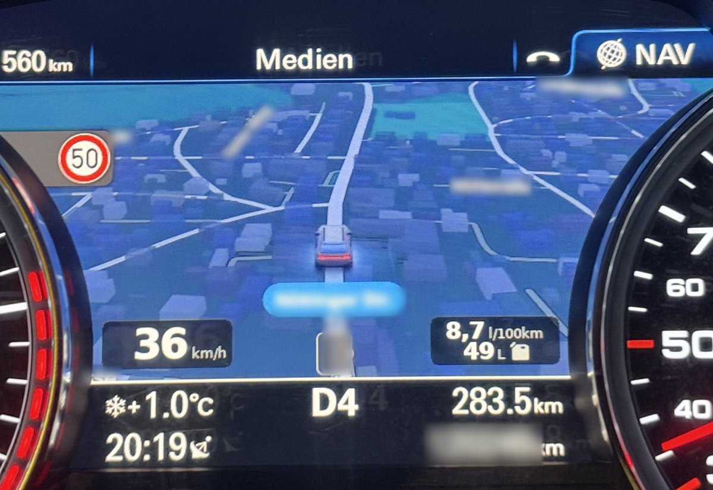

# 14: Our complete setup: everything running together

This page puts it all in one place: **what runs on our car at the same time**, how the pieces fit together,
and **in which order you would build the same thing**. Every piece has its own page with the details; this is
the map.

> Everything here is tested on **one** car: Audi A6 Avant C7.5 (2018), MIB2 High, `MHI2_ER_AU57x_K3663_1`
> (MU1425). Several parts change the Java HMI start or the unit's files. Read [docs/00](00-safety.md), make a
> **full M.I.B. backup** and have each rollback ready before you start.

## What runs at the same time

| # | Piece | Whose work | What it does on our car | Page |
|---|---|---|---|---|
| 1 | **M.I.B.** (More Incredible Bash) | [Mr-MIBonk](https://github.com/Mr-MIBonk/M.I.B._More-Incredible-Bash) | backups, "Run individual script" from the SD card, the QNX `sha1sum` | [docs/00](00-safety.md), [docs/01](01-unit-basics.md) |
| 2 | **CarPlay / Android Auto map in the cockpit** | [MacsInSpace/mib-cluster-map](https://github.com/MacsInSpace/mib-cluster-map) v1.2.6 | the phone's map in the virtual cockpit's navigation tab | [docs/02](02-carplay-map-in-cockpit.md) |
| 3 | **Star button skips tracks + touchpad cursor in CarPlay** | [tfourj/MIB2-Patcher](https://github.com/tfourj/MIB2-Patcher) 1.3.0 (JOKERBTN, TOUCHCURSOR) | joker button = next track in CarPlay, MMI touchpad moves a cursor in CarPlay | [docs/10](10-star-button-and-touchpad-in-carplay.md) |
| 4 | **Custom 3D car model** | ours | RS6 Avant body in silver grey, lowered, RS7 rims, red calipers, black trim, no badge, in the car menu and Audi drive select | [docs/04](04-3d-car-model.md) |
| 5 | **Custom "Car" icon** in the main menu | ours | the same car as the menu icon | [docs/05](05-car-menu-icon.md) |
| 6 | **Safe installer** for `content.kzb` | ours | puts 4 and 5 onto the unit through the SD update, sha1-checked, with automatic backup and uninstall | [docs/06](06-swdl-installer.md) |
| 7 | **VehLog** | ours | reads speed, range and consumption inside the Java HMI, keeps the Audi street name off the cockpit while CarPlay is up, re-arms the boot guards | [docs/11](11-vehicle-data-logger.md), [docs/13](13-cockpit-overlay.md) |
| 8 | **Cockpit overlay** (our build of mib-cluster-map's player) | ours, on top of mib-cluster-map | speed box and fuel box over the CarPlay map | [docs/13](13-cockpit-overlay.md) |
| 9 | **Cockpit fine tuning** | ours, using mib-cluster-map's settings | CarPlay turn card on the right, CarPlay's street name above the cluster's bar | [docs/13](13-cockpit-overlay.md) |

Hardware note: our car also has an aftermarket Android screen with an LVDS box in front of the MMI. It only
passes the MMI's picture through and plays no role for any of the above.

## How the pieces fit together

They touch different places, which is why they can run together:

| Place on the unit | Who changes it |
|---|---|
| `/mnt/app/eso/hmi/lsd/lsd.sh` (Java HMI start) | MIB2-Patcher (JOKERBTN, TOUCHCURSOR) and VehLog: each adds its own marked block with its own boot guard, all join the same `-Xbootclasspath/p:` list |
| Java classes replaced through that list | JOKERBTN: joker/voice button classes · TOUCHCURSOR: touch cursor and CarPlay proxy classes · VehLog: only `org.dsi.ifc.global.CarViewOption`. **No class is replaced twice** (we checked the jars) |
| `content.kzb` (3D model, icons) | our installer only |
| `/mnt/app/navigation/stream-player` | mib-cluster-map installs it, our overlay build replaces it (original kept as `stream-player.mcm126`) |
| mib-cluster-map's setting files in `/mnt/app/root/` | the turn card position (`...-nav.maneuverLayout`) and the safe area (`...-safearea.conf`) through our launcher, original kept |
| `/mnt/persist` | flags and logs of every patch, each with its own names |

The one thing to know: **every Java patch has a boot guard.** If the MMI is switched off or restarted within
about a minute after a start, the next start switches that patch off to be safe. While installing that happens
easily. Our launcher re-arms all of them, and VehLog does it for TOUCHCURSOR and JOKERBTN after a good start.
**After every MMI restart, leave it on for 2 minutes.**

## Building the same thing, in order

Each step is done and checked in the car before the next one. Every step has its own way back.

1. **Backup and access.** Install M.I.B., make a **full backup** including the app backup, and if you can,
   enable its SSH server as a way in if anything ever fails. ([docs/00](00-safety.md), [docs/01](01-unit-basics.md))
2. **CarPlay map in the cockpit.** Install mib-cluster-map v1.2.6 from its release (red menu → Update → SD).
   Check that the map shows in the navigation tab with the iPhone on a cable. ([docs/02](02-carplay-map-in-cockpit.md))
3. **Star button and touchpad.** MIB2-Patcher's JOKERBTN and TOUCHCURSOR through M.I.B. "Run individual
   script". Restart, leave it on 2 minutes, test both. ([docs/10](10-star-button-and-touchpad-in-carplay.md))
4. **Your own car look.** Take `content.kzb` from **your own** backup, build the model and the icon on the PC
   with our tools, check them in the PC preview, install with our SD installer. ([docs/03](03-kzb-format.md),
   [docs/04](04-3d-car-model.md), [docs/05](05-car-menu-icon.md), [docs/06](06-swdl-installer.md))
5. **VehLog.** Convert **your own** `lsd.jxe` to a jar on the PC (it stays on your PC), build VehLog against
   it, run the PC tests, install through "Run individual script". ([tools/vehlog](../tools/vehlog/),
   [docs/11](11-vehicle-data-logger.md))
6. **Cockpit overlay.** Build mib-cluster-map v1.2.6's player with our patch in the open QNX toolchain (first
   the unchanged player, which must come out byte-identical to the released one), run the PC tests, install
   with the same script run. ([tools/speedoverlay](../tools/speedoverlay/), [docs/13](13-cockpit-overlay.md))
7. **Fine tuning.** Box positions and opacity, turn card position, street name filter, CarPlay safe area: all
   small text files on the SD card, applied by the next script run. ([docs/13](13-cockpit-overlay.md#settings-files-on-the-sd-card-applied-by-the-next-script-run))

We do not publish binaries or Audi files: everything is built from your own unit's files and the sources here.

## Our settings

| File | Value |
|---|---|
| `vehlog/speedoverlay.conf` | `pos=bl` `left=175` `bottom=12` `fuel=on` `fuelright=180` `alpha=179` |
| `vehlog/carplay_card.txt` | `right` |
| `vehlog/street_blank.txt` | `on` |
| `vehlog/carplay_safearea.txt` | `36` |
| mib-cluster-map | v1.2.6, default settings |
| MIB2-Patcher | 1.3.0, JOKERBTN (joker = stock function, INFO = previous track, voice = next track / long press voice assistant) and TOUCHCURSOR |

## What is next

We keep testing things that might be useful (see the ideas at the end of [docs/13](13-cockpit-overlay.md#ideas-for-later)
and the research in [docs/07](07-display-manager-and-rear-camera.md)) and will add them here when they work in
the car.
